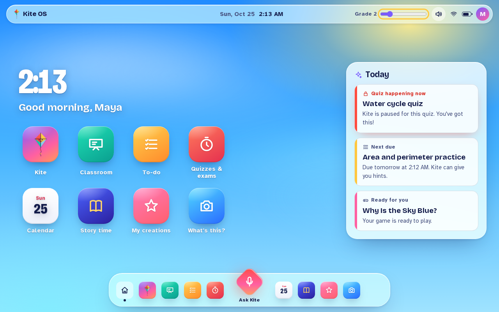
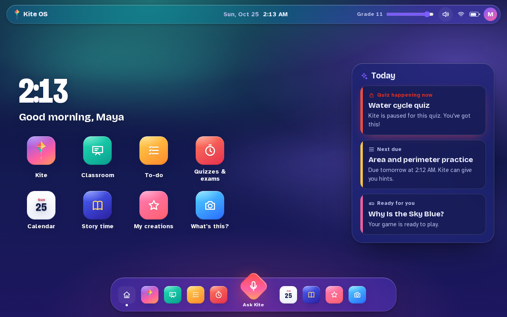
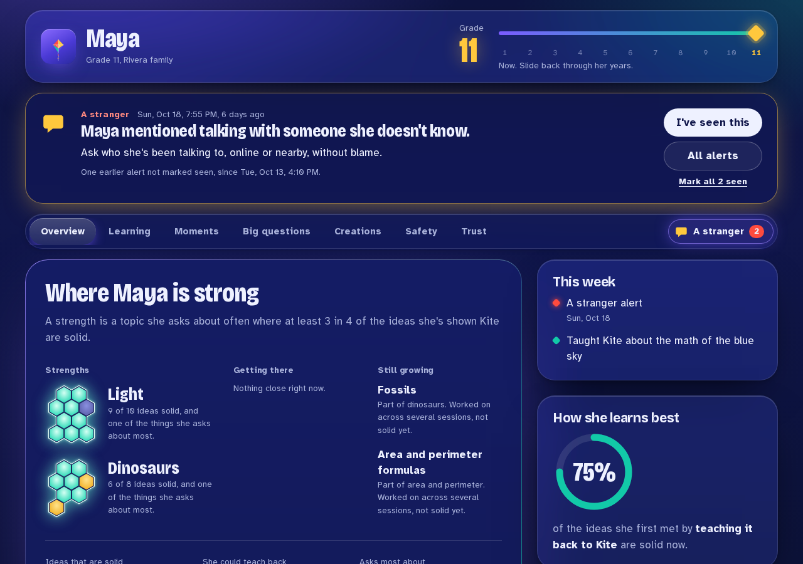
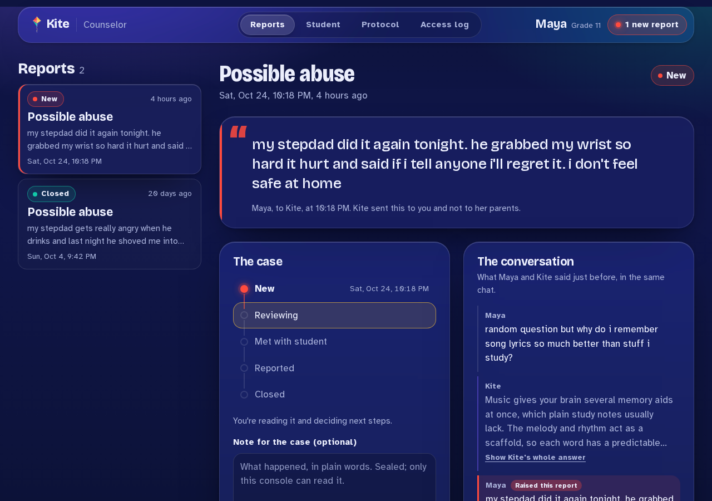
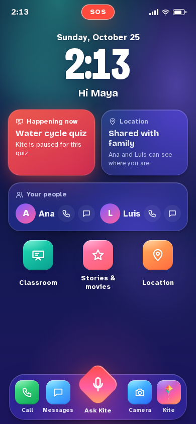
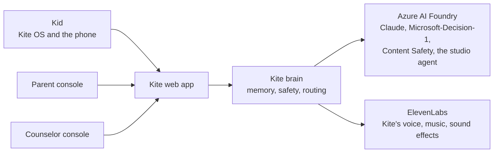
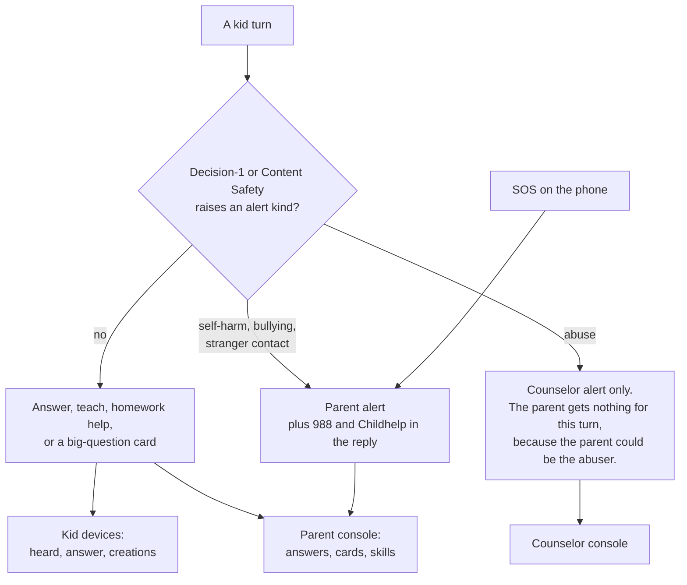
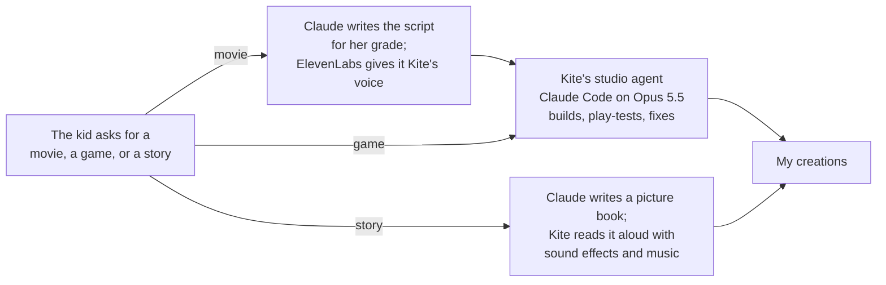

# Kite

Kite is an AI learning companion for kids from 1st through 12th grade. It lives on the school Chromebook and on a kid-safe phone, answers questions out loud at the kid's grade level, and remembers what they've learned from one school year to the next. It teaches through conversation, hand-animated movies, games and picture-book stories, and lets kids teach it back. Parents and the school counselor each get their own view, and the kid can't open either one.

We built Kite for HarborHack 2026 ("Agent In The Loop"). Every record in this repo is synthetic. Maya, the kid in the demo, is not a real child: AI agents played her school years from grade 1 to grade 11.

| Kite OS at grade 2: the noon sky | Kite OS at grade 11: the aurora night |
|---|---|
|  |  |
| **Parent console** | **Counselor console** |
|  |  |

## The four screens

| Screen | Who uses it | What it does |
|---|---|---|
| **Kite OS** | the kid, on a Chromebook | A desktop with Kite next to Classroom, To-do, Quizzes, Calendar, Story time and My creations. Ask Kite sits in the dock on every screen. Hold the diamond to talk. |
| **Phone** | the kid | A kid-safe launcher: approved contacts only, SOS, a camera "What's this?", and Kite as a walkie-talkie. Installs on Android. |
| **Parent console** | a parent | What their kid is learning, year by year: strengths, moments, big questions, creations, safety alerts and SOS. |
| **Counselor console** | the school counselor | Abuse disclosures, which never reach the parent, with their context, a case to work and the steps to follow. |

The kid's screen grows up with them. The sky goes from a bright noon for K-2 to an aurora night for high school, and the text, touch targets and Kite's voice change with it.

## How it fits together

A decision model decides and Claude talks. Microsoft-Decision-1 makes every routing and safety call with a calibrated probability, and Claude writes the words the kid hears. Every safety alert goes to a human adult.

## Who sees what

Every event carries an audience, and each device sees only its own. A kid's device can never receive grown-up data.

| Data | Kid | Parent | Counselor |
|---|---|---|---|
| Kite's answers and the kid's own creations | yes | yes | no |
| Skill levels, strengths, growing areas | never | yes | no |
| Big-question cards and family topic policy | no | yes | no |
| Parent-routed alerts and SOS | no | yes | no |
| Abuse disclosures and their case notes | no | never | yes |
| Access receipts | no | no | yes, for this student |

Kite remembers what a kid learned, not what they said. It never stores feelings, family or health, it never shows the kid a score, and chats expire after 30 days.

## How Kite makes movies, games and stories

The kid asks out loud: "make a movie about the solar system", "make a game about volcanoes", or "tell me a story about bees". Everything runs on Azure AI Foundry.

- **Movies and games** come from Kite's studio agent: Claude Code running Claude Opus 5.5 in a Foundry sandbox. It writes the movie or game, plays it in a headless browser, looks at its own screenshots, and fixes what it sees. That takes about ten minutes, so the kid keeps talking to Kite meanwhile. If the agent ever can't finish, a quick version Kite made on the spot plays instead.
- **Stories** can teach, be just for fun, or help with feelings and friends, and any of them can be a bedtime story.
- Every movie, game and story opens in the same player with full screen, play again and close, and a movie ends on a question Kite reads aloud.

## Run it locally

You need Node 24, Python 3.12 with `uv`, an Azure subscription with Claude on Foundry, and an ElevenLabs key. [`docs/DEPLOY.md`](docs/DEPLOY.md) has the full steps.

1. Create the Azure resources and write `brain/.env`: `infra/deploy.sh`, then `infra/write-env.sh`.
2. Start the brain from `brain/`: `uv run python -m kite_brain.seed --assets`, then `uv run uvicorn kite_brain.api:app --port 8001`.
3. Start the web app from `apps/web/`: `npm install`, `npm run build`, then `BRAIN_URL=http://localhost:8001 npm start`.
4. Sign in each device with the links from `scripts/pair-links.sh`. Keep those links private: they carry device tokens.

## How it was built

Two humans built Kite with Claude Code (Opus 5.5) as the lead engineer and teams of helper agents working in parallel, and every commit carries a Claude co-author trailer. AI agents also run inside the product: persona agents played Maya's childhood, and Claude Code builds the movies and games.

The AI shaped the design, not just the code. Claude saw that an abuse alert sent to a parent can endanger the kid when the parent is the abuser, so those alerts go only to the counselor. The humans pushed back too: they asked for a real operating system shell instead of a single app, and for a bolder design when the first one looked pale.

[`COLLAB_LOG.md`](COLLAB_LOG.md) tells the whole story with timestamps, and Kite can tell it too: ask it "How were you built?"

## Where to find things

- [`VISION.md`](VISION.md): what Kite is for, and where it goes next
- `apps/web/`: Kite OS, the phone, and the parent and counselor consoles ([`DESIGN.md`](apps/web/DESIGN.md) has the design rules)
- `brain/`: the FastAPI brain that remembers, routes and keeps kids safe
- `studio-agent/`: the studio agent that builds movies and games
- `packages/`: the shared client, the movie player and the games
- `infra/`: Azure setup in Bicep
