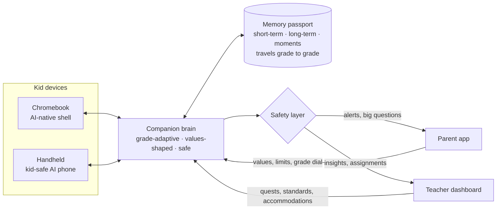

# Kite: an AI companion that grows up with your kid

> Working name. The kid flies the kite; the string keeps it connected to the grown-ups who love them.
> (Alternatives: *Wonderkin*, *Sprout*.)

**One line:** A patient, curious mentor for every child from 1st through 12th grade. It lives on the school Chromebook and in a kid-safe handheld, remembers the child across every grade, teaches each idea the way that child learns best, and keeps parents and teachers in the loop the whole time.

**Theme fit (HarborHack: Agent In The Loop):** the AI is in the loop of a childhood, and humans stay in the loop of the AI.

---

## 1. The problem

- **Kids are question machines, and the hardest questions come at the worst moments.** "Where do people go when they die?" at bedtime. "Why is the sky blue?" in the car. Parents often don't know the answer, or don't know how to say it at a 7-year-old's level. Curiosity that isn't fed fades.
- **School teaches to the middle.** One teacher, 20–30 kids, one explanation. Some kids learn through stories, some through play, some through pictures, and most get a worksheet.
- **Nothing remembers the child.** Every September a new teacher starts from zero. Every edtech app is a fresh login with no history. The only continuous record of how a kid learns lives in a parent's head.
- **Kids already carry the hardware.** Most US K-12 students have a school-issued Chromebook. Today it's either a locked-down browser or a distraction portal. It could be a mentor.

## 2. Why now

- Frontier models can now explain anything at any level, by voice, and can see through a camera.
- NPUs are shipping in Chromebook Plus devices and phones, so a private, on-device companion is a few chip generations away.
- **A cautionary tale shows what to avoid.** In December 2024 Embodied shut down, and its *Moxie* companion robots stopped working because the robot's brain lived in the company's cloud. Kids lost their companion overnight. Kite is designed the other way: the family owns the memory, it's exportable, and the endgame is on-device.

## 3. The ecosystem

### 3.1 The companion brain

- **Grade-adaptive.** Each grade band (K–2, 3–5, 6–8, 9–12) sets vocabulary, sentence length, reading level, depth, analogies, humor, and how Socratic it is. The same question gets a different, right-sized answer at 7, 12, and 17.
- **Personal.** It explains fractions with *your* dinosaurs, physics with *your* soccer. It knows what you already understand and builds on it ("Remember when we figured out why the sky is blue? This is the same light trick.").
- **Values-shaped.** It is tuned to grow curiosity, kindness, honesty, resilience, and a growth mindset. It praises effort over "smart." It models "I don't know, let's find out." It never pretends to be human.
- **A character that grows up too.** The kid names and designs their companion, and it "evolves" each new school year. That makes the grade transition a small ceremony instead of a reset.
- **Honest tech framing.** The hackathon build uses grade-conditioned prompting, retrieved memory, and evals that *measure* reading level. The roadmap is to distill this into small per-grade-band models (LoRA fine-tunes of open-weight models) trained on synthetic and consented data, so they can run on-device.

### 3.2 Memory that travels with the kid (the "learning passport")

| Layer | What it holds | Example |
|---|---|---|
| Short-term | This conversation | "You just said the triangle has 3 equal sides" |
| Long-term profile | Interests, favorite characters, how they learn best, mastered skills, misconceptions | "Loves T. rex. Learns best with stories. Mixes up area and perimeter." |
| Moments | Milestones worth remembering | "Oct 2027: figured out why the sky is blue" |

- It carries over from grade to grade and school to school.
- **The family owns it.** Parents can export it and delete it, and the kid inherits it at 18.
- **New-teacher handoff (with consent):** "Meet your new student" briefs each September.

### 3.3 Learn it your way

| Mode | What happens |
|---|---|
| **Ask** (voice or chat) | Any question, answered at your level, anywhere |
| **Storybook** | The topic becomes an illustrated, narrated story starring your favorite character, or starring *you* |
| **Game** | The companion builds a playable mini-game that teaches the concept. The kid can remix it ("make the asteroids faster"), so the kid is the designer, which builds computational thinking |
| **Show me** (camera) | Point at a bug, a leaf, a worksheet, or a cloud and get an explanation |
| **Teach it back** | The companion plays a confused student and the kid teaches it, which locks in learning (the protégé effect) |
| **Homework mode** | Hints and questions, not answers. Teachers set the strictness per assignment, which addresses the cheating worry |
| **Curiosity quests** | A question of the day and offline challenges ("find 3 kinds of leaves and tell me how they differ") that push the kid outdoors and toward making things |
| **Animated video** | A short, narrated cartoon generated in under a minute: storyboard, then illustrated scenes, then character voices, then an animated player. Shares one engine with storybooks and games |

### 3.4 The devices

- **Chromebook: an AI-native shell.** A full-screen, companion-first experience. Go-to-market is a managed ChromeOS app or kiosk that districts force-install from the Google Admin console, so we don't need to replace the OS to ship to schools. Long-term, a custom ChromeOS Flex or Linux image where the companion *is* the shell.
- **Handheld: a kid-safe AI phone.** The companion is at the center: voice-first, push-to-talk like a walkie-talkie. Around it: calls and texts to approved contacts only, SOS, location sharing with parents, camera, maps, and field-trip mode. No app store, no social feeds, no browser.
  - Hackathon: a native Android launcher app, or the web app installed on the phone (team decision D1).
  - Real product: dedicated hardware with an on-device model.
- **Same brain and same memory on both.** Something asked on the bus can continue on the Chromebook in class.

### 3.5 Grown-ups in the loop

**Parents**

- A curiosity map: what the kid wonders about, and how that changes over the years.
- Strengths, growing areas, and concrete suggestions ("Maya lights up with stories. Try reading *The Magic School Bus* together.").
- **Big-question alerts with conversation starters.** "Maya asked about death today. Here's what Kite said, and here's how you could continue the conversation tonight." This helps the *parents* with the awe questions too.
- **Family values settings** for sensitive topics (death, religion, bodies, war, divorce). For each topic, parents choose whether Kite answers, answers and loops them in, or says "that's a great one to ask your mom or dad."
- Controls: grade-level dial, time limits, quiet hours, homework strictness, language, and the companion's character.
- **Transcripts with graduated privacy.** Parents see everything at K–5. Teens earn more privacy, but safety alerts always go through. Kids should grow into autonomy.

**Teachers**

- A class view: who's stuck on what, and misconception clusters across the class.
- Assign a "learning quest," and each kid's companion delivers it in that kid's best mode.
- Standards alignment (Common Core, NGSS) and IEP/504 accommodations built in.

### 3.6 Safety, privacy, trust (non-negotiable)

- **Compliance:** COPPA (verifiable parental consent under 13), FERPA (school records), CIPA (school filtering), and state student-privacy laws.
- **Business promises:** no ads, no selling data, and no optimizing for engagement time.
- **Guardrails:** grade-appropriate content policy on input and output, kind redirects instead of cold refusals, and an escalation protocol. Self-harm, abuse disclosure, bullying, or a stranger contact triggers an immediate parent alert and crisis resources.
- **Anti-dependency by design:** Kite pushes the kid *outward*, toward friends, family, the outdoors, and building things. It has time limits, is clearly an AI, and avoids parasocial patterns.
- **Transparency:** parents see what Kite told their kid, and we publish our safety and reading-level eval scores.
- **On-device endgame:** no cloud means no breach and no shutdown that bricks a kid's friend.

**Memory framing: "The cloud thinks. The family remembers."** We separate the brain (computation, rentable from the cloud) from the memory (data about the child, owned by the family).

| Phase | How memory is protected |
|---|---|
| **Now** | Encrypted per family. A passkey unlocks the parent dashboard. Access receipts. Audio and photos are never stored |
| **Pilot** | Family-held keys. Our cloud keeps only a backup it can't read. The device sends just the memories needed for one answer. A two-guardian rule for adding adults |
| **On-device** | The model runs on device chips. The cloud gets topics, never the child |
| **Fully family-held** | The passport lives in the handheld's secure chip |

- **Three kinds of memory:**
  - Learning: teachers see this layer
  - Personal: parents only, and it fades over time
  - Safety: never stored in the passport; it goes to the restricted alert path
- **The kid can say "Kite, forget that"** and can see what Kite remembers.
- **Don't claim "even we can't read it"** until the family-held keys phase.

### 3.7 Inclusion and accessibility

- Read-aloud for everything, and dyslexia-friendly type.
- Short-burst mode for ADHD.
- Bilingual support: the kid learns in English while the parent dashboard is in the family's home language.
- IEP-aware accommodations. Special education is a large underserved need with dedicated funding (IDEA).

## 4. Who pays

| Channel | Buyer | Model |
|---|---|---|
| **B2B (schools)** | School districts | Per-student annual license: Chromebook companion plus teacher dashboard |
| **B2C (families)** | Parents | Subscription for home use, plus the handheld (hardware plus monthly plan, like Gabb, Bark Phone, or Troomi kid phones) |
| **B2B2C** | School-led, family-upgraded | The school pays for in-class use, and families upgrade to the handheld and home modes |

- **Comparables:** Khanmigo (Khan Academy, district tutor), Google Gemini for Education, MagicSchool (teacher tools), Synthesis Tutor (home math), kid-safe phones (Gabb, Bark, Troomi), and companion robots (Miko, plus Moxie as the cautionary tale).
- **The gap none of them fill:** one companion that follows the *same kid* across *12 years* and *every device*, with the family in the loop.
- **Market:** about 49M US public K-12 students (NCES). *Verify current figures before going on stage.*
- **Moat:** the relationship and its quality, not holding data hostage. Families can export everything.

## 5. Roadmap

| Phase | What ships |
|---|---|
| **0: HarborHack** | Kite OS on the laptop, the phone app, grade-adaptive answers, memory, animated movie and game modes, parent dashboard with passkey unlock, safety layers, evals |
| **1: Pilot** | One classroom and one cohort of families, consent flows, standards mapping, teacher view |
| **2: Own models** | Distilled per-grade-band models and an offline mode on Chromebook Plus NPUs |
| **3: Hardware** | Dedicated handheld with an on-device model, and a companion OS image for Chromebooks |

---

## Where the AI teammate shaped this (for the Collaboration Story)

**What Claude pushed back on**

- "Fine-tuned model per grade" was reframed as grade-conditioned prompting plus measured reading level now, with fine-tuning on the roadmap. Fine-tuning isn't feasible or provable in 30 hours.
- "A new OS for Chromebooks" was reframed as an AI-native shell deployed as a managed ChromeOS app. That's buildable this weekend and is also the real go-to-market, since districts deploy apps rather than replace OSes.
- For the handheld, Claude proposed one web app on two form factors instead of an Android app. The humans pushed back ("not a simulator"), so a native launcher app is back on the table as team decision D1.

**What Claude added to the vision**

- Family values settings and big-question conversation starters for parents
- Graduated teen privacy
- Homework mode
- Teach-it-back mode
- Curiosity quests and anti-dependency design
- The learning passport (family-owned, inherited at 18)
- The Moxie shutdown lesson as the case for on-device
- A companion character that "evolves" each grade
- Teacher class view and IEP support
- Accessibility and bilingual parents
